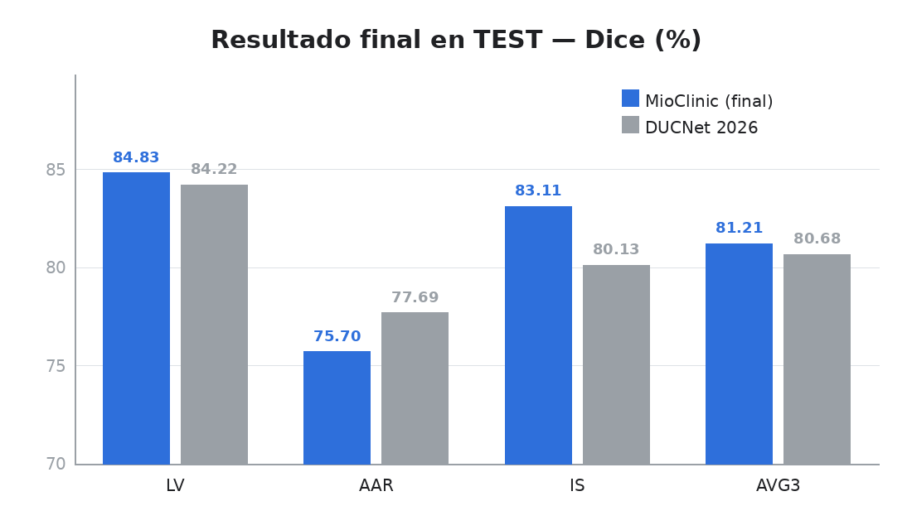
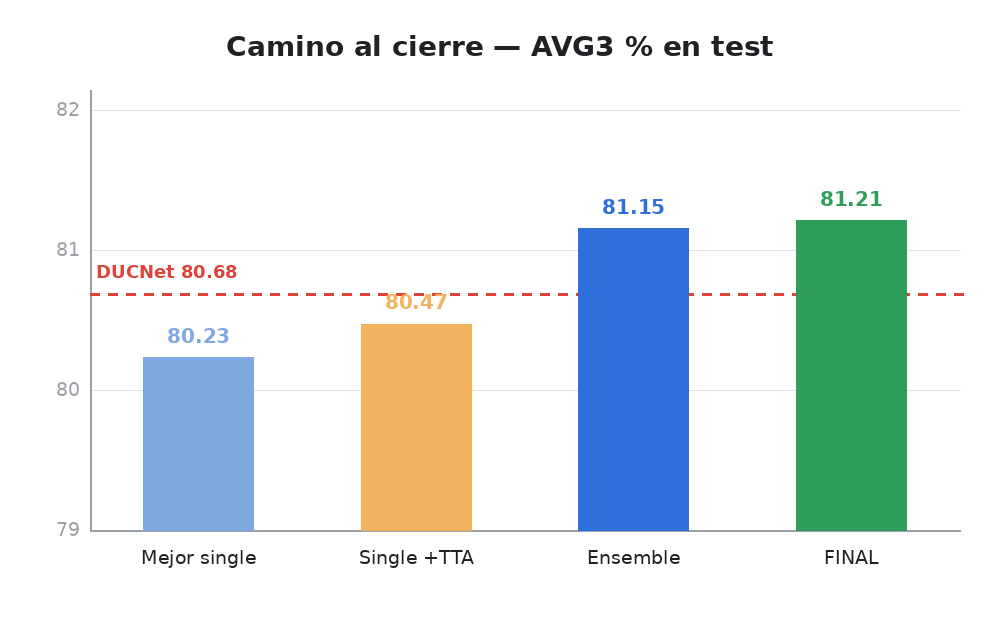
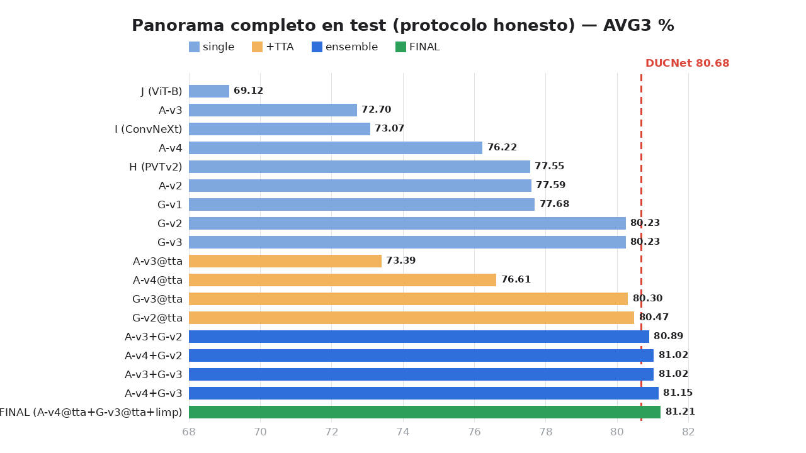

# Comparativa visual — MioClinic vs DUCNet (16-oct-2026)

**Mismo dataset y split que el paper** (ratón, 171/35/37). **Resultado: el protocolo
final supera a DUCNet por +0.53 puntos** en la métrica oficial (AVG Dice).

---

## 1. El problema → el fix

El protocolo viejo medía 8-30 *tiles aleatorios* por imagen → números inflados
(no comparables con el paper). Se re-midió todo con ventana deslizante sobre la
imagen completa (mismo kit para todos):

| Ejemplo (A-v2) | Protocolo viejo (tiles) | Protocolo honesto | Brecha |
|---|---|---|---|
| Dice AVG | 89.7 % | 77.6 % | **−12.1 pts** |

## 2. Resultado final vs DUCNet (test)

| Clase | MioClinic (final) | DUCNet | Δ |
|---|---|---|---|
| LV | 84.83 | 84.22 | **+0.61** |
| AAR | 75.70 | 77.69 | −1.99 |
| IS | 83.11 | 80.13 | **+3.00** |
| **AVG3** | **81.21** | **80.68** | **+0.53** |

*HD/HD95 no comparable directamente (granularidad del paper no especificada);
detalle y análisis en `HALLAZGOS_16OCT.md §5`.*

## 3. El camino al cierre

Ensemble U-Net+Swin (α=0.5) + TTA flips×4 + limpieza de islas (<4000 px).
Elegido en **val** (regla pre-registrada) y aplicado **una sola vez** en test.

## 4. Panorama completo (test, protocolo honesto)

## 5. Cambios clave del proyecto

| # | Cambio | Para qué |
|---|---|---|
| 1 | Kit de evaluación honesta full-image | Medir lo mismo que el paper (sin sesgo de tiles) |
| 2 | Fix del freeze del encoder (era no-op) | Transfer learning real en las U-Net |
| 3 | Fix del scheduler | LR decay correcto en todos los runs |
| 4 | bf16 verificado == fp32 | 2× más rápido, sin pérdida de precisión |
| 5 | Limpieza por componentes (r=2, 4000 px) | Elimina islas: HD95 −9…−211 px en val |
| 6 | TTA flips×4 | +0.26…+0.78 pts en val |
| 7 | Ensembles CNN+Transformer | 4/4 superan a DUCNet por sí solos |
| 8 | Selección en val + test one-shot | Defensa metodológica (sin tuning en test) |

*Fase 3 preparada (Tversky, selección de checkpoint por val): configs listas.*

## Rutas

- Informe completo + caveats: `docs/HALLAZGOS_16OCT.md`
- Tablas por run: `runs/eval_honest/SUMMARY.md` · `COMPARATIVA_HONESTA.md`
- Resultado final: `runs/eval_cleanup_final/A-v4@tta+G-v3@tta.json`
